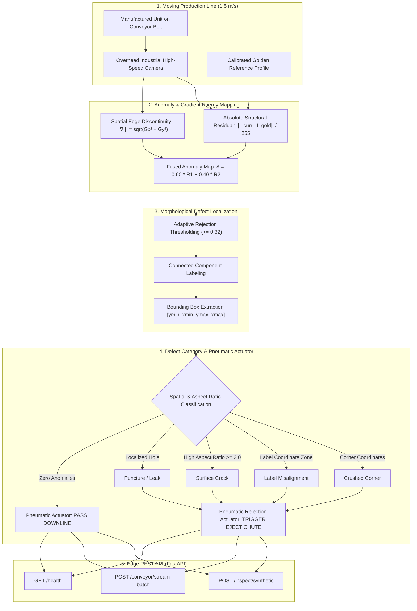

# Conveyor Product Defect Inspection & Pneumatic Sorting Engine

[](https://github.com/yakupakcy36/conveyor-product-defect-inspection/actions)
[](https://www.python.org/downloads/)
[](https://fastapi.tiangolo.com/)
[](https://opensource.org/licenses/MIT)

An industrial Automated Optical Inspection (AOI) computer vision system for **high-speed manufacturing conveyor lines (120+ PPM)**. Detects packaging punctures, crushed container corners, misaligned/torn labels, and surface fractures, triggering real-time **pneumatic rejection actuators** to divert defective inventory.

Built on local NumPy/SciPy optical tensor pipelines with **zero external paid API dependencies** and sub-15ms frame latencies.

---

## 🏛️ Conveyor Vision Architecture



---

## 🔬 Failure Modes & Spatial Formulations

On a high-speed packaging conveyor, defective items exhibit distinct spatial and optical signatures:

1. **Puncture / Seal Leak:**  
   High-contrast circular perforation on container body. Characterized by localized intensity collapse ($\Delta I > 120$) and compact circular geometry.
2. **Crushed Corner:**  
   Structural geometric collapse at container corners ($(y \le 68 \lor y \ge 195) \land (x \le 75 \lor x \ge 180)$), replacing packaging luminance with the dark conveyor belt background.
3. **Label Misalignment & Tearing:**  
   Displacement or rotational shear across front branding zone ($95 \le y \le 175$, $80 \le x \le 176$), inducing large-area residual gradients ($> 180\,\text{px}$).
4. **Surface Crack:**  
   High-gradient structural fracture lines characterized by anisotropic aspect ratios ($\text{Aspect Ratio} \ge 2.0$).

---

## 📁 Repository Structure

```text
conveyor-product-defect-inspection/
├── .github/workflows/ci.yml     # Automated GitHub Actions CI pipeline
├── src/
│   ├── config.py                # Resolution, conveyor speed, thresholds
│   ├── generator.py             # Packaging & conveyor frame synthesizer
│   └── detector.py              # Anomaly mapping, bbox extraction & pneumatic trigger
├── api/
│   ├── schemas.py               # Pydantic v2 data models
│   └── app.py                   # FastAPI service (/inspect, /stream-batch, /health)
├── tests/                       # Unit & integration test suite
├── Dockerfile                   # Production container definition
├── docker-compose.yml           # Local service orchestration
└── requirements.txt
```

---

## 🚀 Quickstart & Reproduction

```bash
# 1. Install dependencies
pip install -r requirements.txt

# 2. Execute test suite
pytest -v

# 3. Launch edge inspection service
uvicorn api.app:app --host 0.0.0.0 --port 8000
```

---

## 📡 API Reference

* **`POST /inspect/synthetic`**: Inspects a conveyor frame and returns `pass_status` (`PASS` or `REJECT`), `rejection_actuator_triggered` boolean, `primary_defect_type`, bounding boxes, and latency.
* **`POST /conveyor/stream-batch`**: Simulates a batch of consecutive items traveling down the conveyor belt and reports throughput PPM (Parts Per Minute) and scrap rate percentage.
* **`GET /health`**: Returns camera readiness, actuator status, and target PPM.

---

## 📄 License
MIT License.
